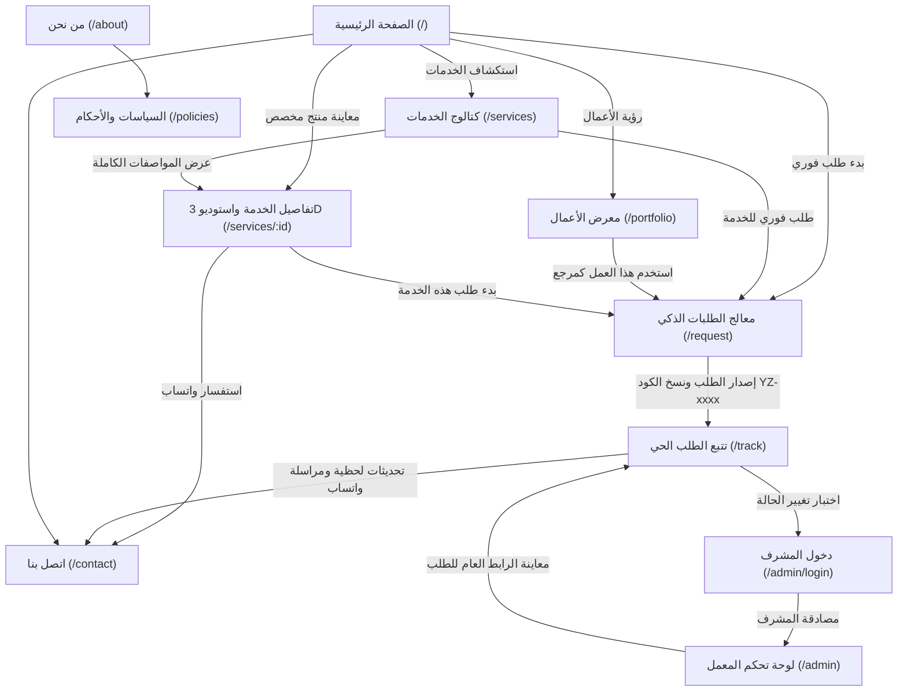

# دليل التوثيق الشامل لصفحات المنظومة (MD Files Directory)

مرحباً بك في مجلد التوثيق الشامل لمنصة وكالة **«يوزرسيف» (Yuzersef)** للطباعة والتطريز والتخصيص في أسوان ومصر.

يحتوي هذا المجلد على ملفات توثيق تفصيلية فائقة الدقة لكل صفحة من صفحات المنظومة على حدة، بحيث تشرح الغرض الوظيفي، الهيكل المعماري، إدارة الحالة، نماذج البيانات، قواعد التحقق، التنسيقات البصرية، ومسارات التفاعل.

---

## فهرس ملفات التوثيق والصفحات (Master Page Index)

| # | اسم الملف التوثيقي | اسم الصفحة بالعربية | المسار (Route) | ملف المصدر (Source Component) | الصلاحية |
| :---: | :--- | :--- | :--- | :--- | :---: |
| 1 | [Home.md](./Home.md) | **الصفحة الرئيسية** | `/` | `src/pages/Home.tsx` | عامة |
| 2 | [About.md](./About.md) | **من نحن / عن الوكالة** | `/about` | `src/pages/About.tsx` | عامة |
| 3 | [Services.md](./Services.md) | **دليل الخدمات والكتالوج** | `/services` | `src/pages/Services.tsx` | عامة |
| 4 | [ServiceDetails.md](./ServiceDetails.md) | **تفاصيل الخدمة واستوديو المعاينة** | `/services/:id` | `src/pages/ServiceDetails.tsx` | عامة |
| 5 | [Portfolio.md](./Portfolio.md) | **معرض الأعمال والنماذج السابقة** | `/portfolio` | `src/pages/Portfolio.tsx` | عامة |
| 6 | [RequestWizard.md](./RequestWizard.md) | **معالج تقديم الطلبات وفاحص الجاهزية** | `/request` | `src/pages/RequestWizard.tsx` | عامة |
| 7 | [TrackRequest.md](./TrackRequest.md) | **تتبع مسار وحالة الطلب** | `/track` | `src/pages/TrackRequest.tsx` | عامة |
| 8 | [Contact.md](./Contact.md) | **اتصل بنا والاستشارات المباشرة** | `/contact` | `src/pages/Contact.tsx` | عامة |
| 9 | [Policies.md](./Policies.md) | **السياسات والشروط والأحكام** | `/policies` | `src/pages/Policies.tsx` | عامة |
| 10 | [AdminLogin.md](./AdminLogin.md) | **تسجيل دخول لوحة الإدارة** | `/admin/login` | `src/pages/AdminLogin.tsx` | مدخل أمني |
| 11 | [AdminDashboard.md](./AdminDashboard.md) | **لوحة تحكم إدارة المعمل وخط الإنتاج** | `/admin` | `src/pages/AdminDashboard.tsx` | مسؤولين |

---

## خريطة تدفق المستخدم والتنقل بين الصفحات (User Flow Diagram)

---

## أبرز المزايا والابتكارات الفنية الموثقة بالتفصيل

1. **فاحص الجاهزية اللحظي (Smart Request-Readiness Assistant):**
   - موجود في [RequestWizard.md](./RequestWizard.md).
   - يقوم بحساب مجموع المقاسات الموزعة (`S + M + L + XL + XXL`) ومطابقتها التلقائية مع كمية الطلب الإجمالية لمنع أخطاء الطلب الشائعة.
2. **محاكي استوديو المنتجات التفاعلي (Interactive Turntable Product Studio):**
   - موجود في [ServiceDetails.md](./ServiceDetails.md).
   - يوفر زوايا دوران متعددة وتراكب شعارات العملاء بصرياً على الأقمشة والأكواب والجرابات.
3. **نظام الإحالة المرجعية المباشر (Use as Reference Pipeline):**
   - موجود في [Portfolio.md](./Portfolio.md) و [Home.md](./Home.md).
   - ينقل عنوان العمل المرجعي من المعرض مباشرة إلى خانة فكرة الطلب في معالج الطلبات.
4. **تتبع خط الإنتاج ذو الخمس مراحل والتوجيه المباشر للخطوة التالية (`Next Step`):**
   - موجود في [TrackRequest.md](./TrackRequest.md).
   - يقدم إرشادات لحظية مكتوبة من إدارة معمل أسوان وتحديثات فورية لكل طلب.
5. **لوحة تحكم المشرف الشاملة (Admin Operations Suite):**
   - موجود في [AdminDashboard.md](./AdminDashboard.md).
   - توفر 7 بطاقات KPI لحظية، وإدارة شاملة لحالات الطلبات، وتعديل الملاحظات، وربط الواتساب المباشر للعملاء.
